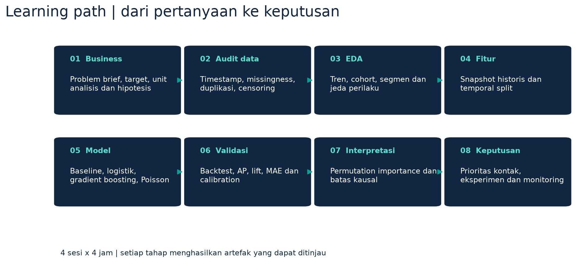

# Learning path — Insurance Behavior Lab

Materi 16 jam, empat sesi x empat jam, untuk mahasiswa yang telah mengenal Python dasar.
Seluruh data merupakan simulasi. Tidak diperlukan GPU atau akses data nasabah asli.

## Kompetensi akhir

Peserta mampu merumuskan pertanyaan bisnis, membangun snapshot yang benar secara waktu,
melakukan EDA dengan denominator yang tepat, melatih dan membandingkan model, mengevaluasi
prediksi pada masa depan, menjelaskan keterbatasan, serta merancang tindakan dan eksperimen.

## Sesi 1 — Bisnis, data dan EDA (240 menit)

| Waktu | Aktivitas | Materi | Hasil |
|---|---|---|---|
| 0–30 | Diskusi kasus | Harga +10%, churn tertunda, campaign dan demand | Problem brief |
| 30–60 | Susun hipotesis | Prediksi vs sebab, falsifiability, data tambahan | Matriks hipotesis |
| 60–90 | Inspeksi data | Customer-month, label, timestamp, missingness | Data dictionary dan audit |
| 90–105 | Istirahat | | |
| 105–160 | EDA timeline | Rate vs count, denominator, survivorship | Grafik churn dan akuisisi |
| 160–205 | Segmen dan cohort | Renewal x tunggakan, inception, censoring | Dua grafik dan interpretasi |
| 205–240 | Presentasi EDA | Fakta, hipotesis, hal belum diketahui | Memo satu halaman |

Konsep kunci: observasi tidak identik dengan penjelasan. "Tidak terlihat perubahan" tidak
sama dengan "efeknya tidak signifikan". Penilaian membutuhkan pembanding dan ketidakpastian.

## Sesi 2 — Feature engineering dan baseline (240 menit)

| Waktu | Aktivitas | Materi | Hasil |
|---|---|---|---|
| 0–35 | Label dan leakage | Snapshot awal bulan, label matang bulan berikutnya | Diagram waktu |
| 35–80 | Rekayasa fitur | Riwayat 3 bulan, premium-to-income, interaksi | Feature contract |
| 80–115 | Audit split | Train, embargo, validation dan test | Tabel split |
| 115–130 | Istirahat | | |
| 130–175 | Preprocessing | Imputer, scaler, one-hot dan Pipeline | Pipeline fit pada train |
| 175–210 | Baseline | Prevalensi dan logistic regression | Tabel metrik baseline |
| 210–240 | Diskusi | Accuracy, AP dan ROC-AUC | Penjelasan metrik |

Tugas: tunjukkan tiga contoh fitur yang akan membocorkan masa depan, misalnya alasan cancel,
tanggal polis ditutup, atau pembayaran yang baru tercatat setelah snapshot.

## Sesi 3 — Model dan validasi (240 menit)

| Waktu | Aktivitas | Materi | Hasil |
|---|---|---|---|
| 0–40 | Model nonlinear | Gradient boosting, regularisasi dan interaksi | Kandidat model |
| 40–85 | Rolling backtest | Tiga origin historis, embargo | Tabel stabilitas |
| 85–115 | Model selection | AP validation; final test tetap terpisah | Model terpilih |
| 115–130 | Istirahat | | |
| 130–170 | Capacity metrics | Precision, recall, lift top 10% per bulan | Daftar prioritas |
| 170–205 | Probabilitas | Brier, reliability diagram, error analysis | Diagnostic memo |
| 205–240 | Interpretasi | Permutation importance dan customer bootstrap | Dua batas kesimpulan |

Tugas: jika model rumit kalah dari logistik, jelaskan kemungkinan sebab. Jangan mengganti model
menggunakan test. Laporan hasil yang jujur memiliki nilai lebih tinggi daripada metrik terbesar.

## Sesi 4 — Akuisisi, keputusan dan komunikasi (240 menit)

| Waktu | Aktivitas | Materi | Hasil |
|---|---|---|---|
| 0–45 | Akuisisi | Weekly lag, baseline lag-1, model Poisson | Forecast satu langkah |
| 45–80 | Anomali | Residual dan batas yang fit pada validation | Antrean investigasi |
| 80–115 | Keputusan | Kapasitas kontak dan skenario biaya | Sensitivity table |
| 115–130 | Istirahat | | |
| 130–175 | Eksperimen | Randomisasi, ITT, incrementality, guardrail | Experiment brief |
| 175–205 | Engineering | Artifact, batch scoring, manifest dan monitoring | Reproduksi scoring |
| 205–240 | Pitch | Lima menit per kelompok dan feedback | Presentasi akhir |

## Matriks hipotesis yang digunakan peserta

| Fenomena | Hipotesis | Data untuk menguji | Apa yang dapat membantahnya? |
|---|---|---|---|
| Bertahan setelah kenaikan | Keputusan menunggu renewal | Tanggal renewal, notice, cancel request | Pola sama kuat jauh dari renewal |
| Churn melonjak | Tunggakan terkumpul | Riwayat pembayaran dan grace period | Tidak ada kenaikan tunggakan sebelum churn |
| Campaign sepi | Respons terlambat | Exposure, tanggal quote, conversion cohort | Tidak ada pola pada lag di holdout |
| Akuisisi ramai | Referral dan pencarian organik | Source attribution dan referral logs | Peningkatan hanya berasal dari perubahan tracking |

Bukti yang membantah adalah bahan belajar, bukan kegagalan peserta.

## Penilaian

| Komponen | Bobot | Kriteria |
|---|---:|---|
| Business framing | 20% | Unit, target, hipotesis dan sukses terukur |
| Data dan EDA | 25% | Timestamp, denominator, cohort dan visual |
| Modeling dan validasi | 30% | Baseline, waktu, metrik dan reproducibility |
| Insight dan keputusan | 15% | Sesuai bukti dan asumsi eksplisit |
| Eksperimen dan komunikasi | 10% | Counterfactual, outcome dan pitch jelas |

Syarat semua komponen: kode berjalan, data sintetis disebutkan, serta tidak menganggap
feature importance atau korelasi sebagai bukti penyebab. Challenge tambahan: ablation fitur
pendapatan dan kelompok pendapatan; desain kalibrasi temporal; evaluasi cohort baru.
